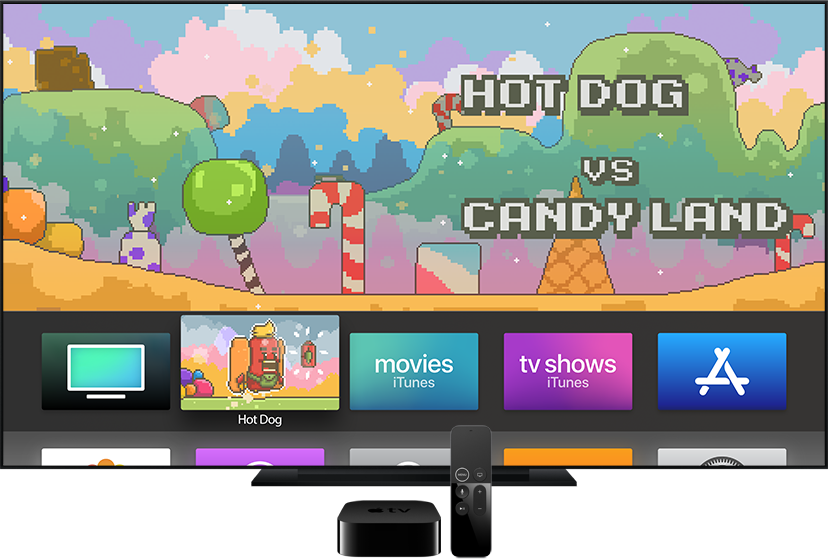
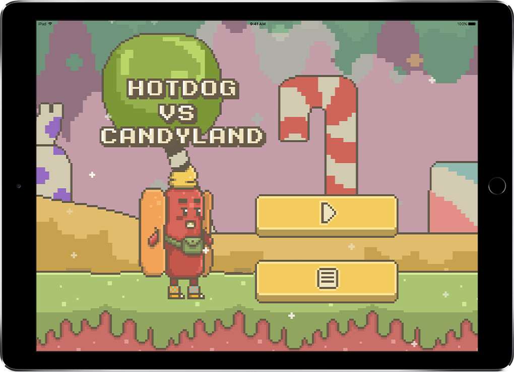

# Hot Dog vs. Candy Land

## Run Hot Dog, Run...

Hot Dog vs. Candy Land is a charming and relaxing endless runner featuring colorful visuals, playful environments, and a unique gravity-switching mechanic.

Run, jump, and defy gravity as you guide our brave Hot Dog through the deliciously dangerous world of Candy Land!

### Where to Get the Game

Hot Dog vs. Candy Land is available on the Apple App Store for iPhone, iPad, and Apple TV.

---

## Privacy Policy

**Last updated: November 20, 2026**

Hot Dog vs. Candy Land ("the Game") is developed and maintained by the Hot Dog vs. Candy Land Team ("we", "us", or "our").

We believe that playing a game should be fun, simple, and respectful of your privacy.

This Privacy Policy explains how information is handled when you play Hot Dog vs. Candy Land on iPhone, iPad, or Apple TV.

### 1. Information Collection and Use

**We do not collect personal information or track our players.**

Hot Dog vs. Candy Land does not require registration, user accounts, or the submission of personal information.

The Game does not collect or transmit personal information, device identifiers, location information, or gameplay activity to our servers.

We do not use advertising networks, analytics services, or tracking technologies.

Our goal is simple: to provide an enjoyable gaming experience without compromising your privacy.

### 2. Local Data Storage

Hot Dog vs. Candy Land uses RealmSwift, a local database framework, to store gameplay-related information directly on your device.

This information is used exclusively to support the Game's functionality and remains stored locally.

We do not access, collect, transmit, or synchronize this information with external servers.

Locally stored game data can generally be removed by deleting the Game from your device, subject to any backups maintained by your operating system.

### 3. Third-Party Services

The Game does not integrate third-party advertising, analytics, or user-tracking services.

RealmSwift is used solely for local data storage and does not transmit gameplay information to external services.

Downloads, purchases, and other services provided directly by Apple are governed by Apple's own privacy practices.

For additional information, please review the [Apple Privacy Policy](https://www.apple.com/legal/privacy/).

### 4. Data Sharing

We do not sell, rent, or share players' personal information with third parties for advertising, marketing, analytics, or profiling purposes.

Because we do not collect player information through the Game, we do not maintain any external database of player profiles or gameplay activity.

### 5. Children's Privacy

Hot Dog vs. Candy Land is designed to provide an enjoyable gaming experience without requiring personal information from players of any age.

The Game does not knowingly collect personal information from children or adults.

It does not include advertising, behavioral tracking, or data collection features intended to profile players.

### 6. Contact and Support Information

If you contact us voluntarily by email, we will receive the information you choose to provide, such as your email address and the contents of your message.

This information will be used only to respond to your inquiry, provide technical support, or address your feedback.

Support correspondence is handled outside the Game and is not used for advertising, analytics, or tracking.

### 7. Changes to This Privacy Policy

We may update this Privacy Policy from time to time to reflect changes to the Game, its features, or applicable privacy requirements.

Any updates will be published on this page, and the "Last updated" date will be revised accordingly.

Changes will become effective when the updated Privacy Policy is published.

We encourage you to review this page periodically.

### 8. Contact Us

If you have any questions, concerns, or suggestions regarding this Privacy Policy, please contact us at:

**Email:** [hvscandyland@gmail.com](mailto:hvscandyland@gmail.com)

We will make reasonable efforts to respond to your inquiries.

---

## Support

Having trouble with Hot Dog vs. Candy Land?

We're happy to help! If you experience any issues, have questions, or simply want to share feedback, please [contact our support team](mailto:hvscandyland@gmail.com).

Thank you for playing Hot Dog vs. Candy Land, and happy running!